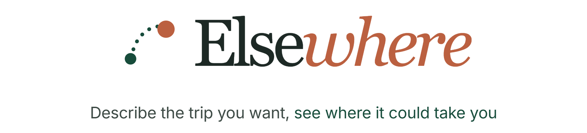
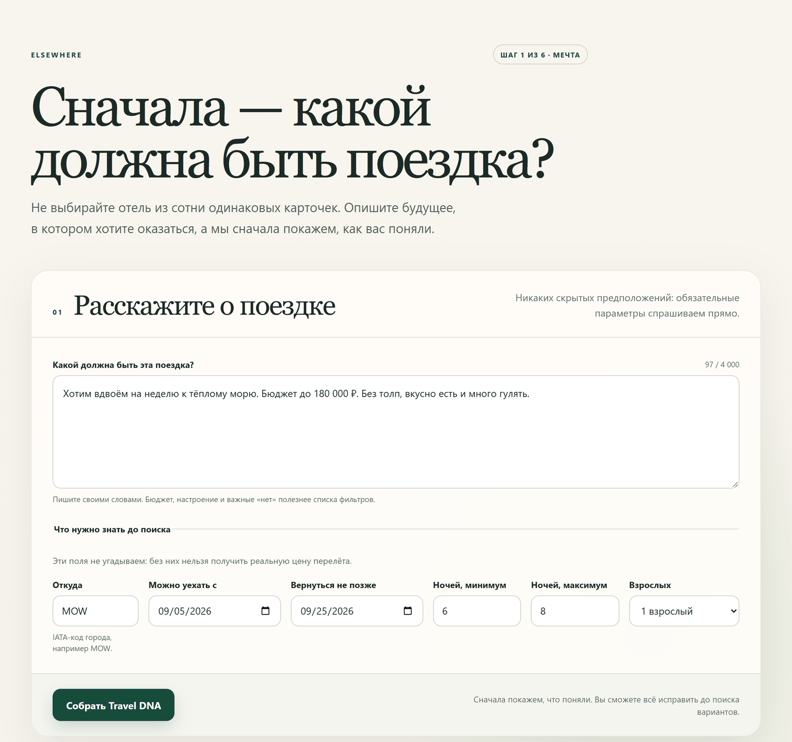
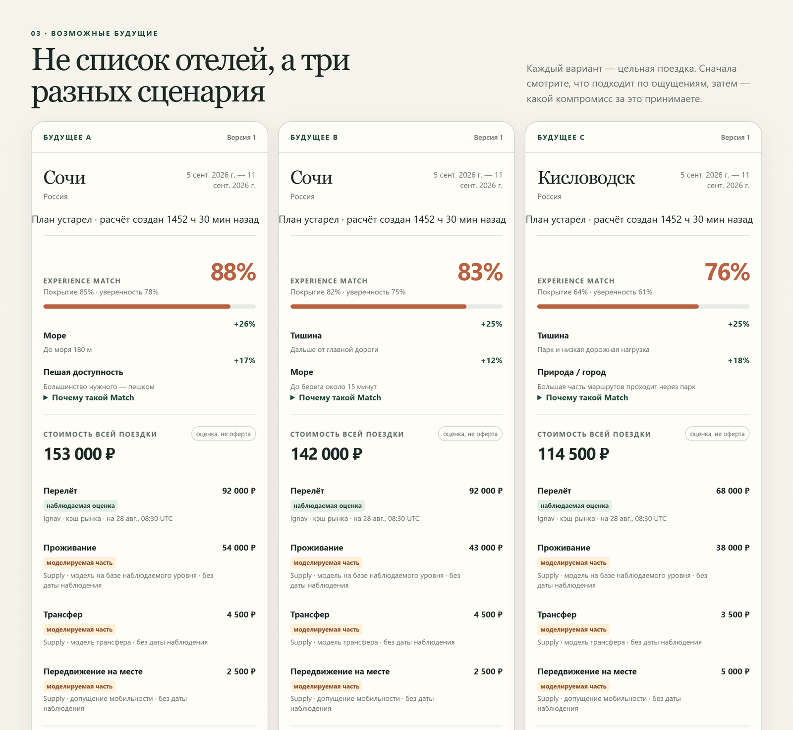
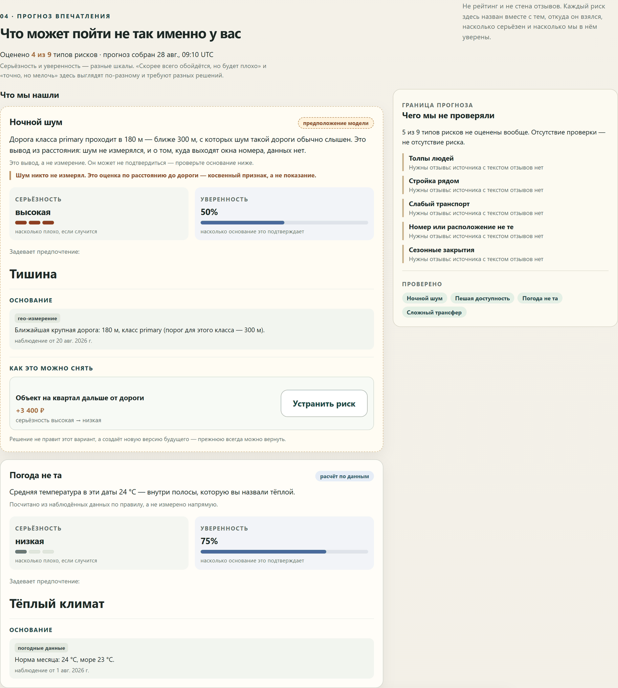
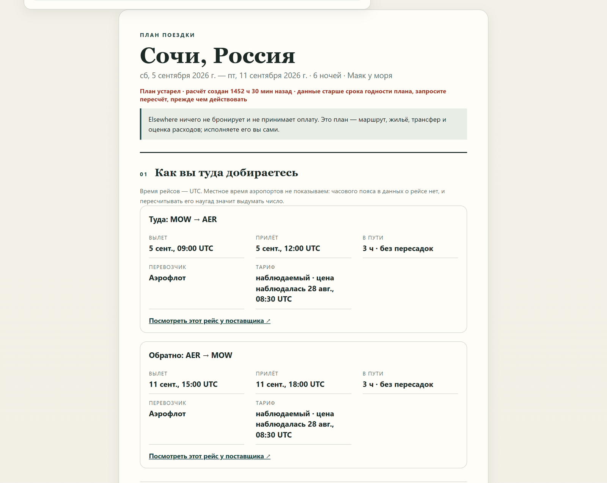
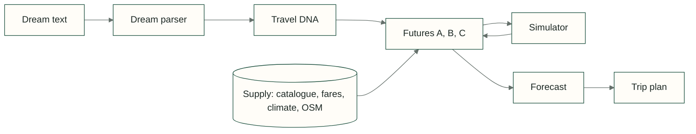

<p align="center">
  <picture>
    <source media="(prefers-color-scheme: dark)" srcset="docs/readme/banner.dark.png">
    
  </picture>
</p>

<p align="center">
  A trip planner for people who know how they want to rest but not yet where. Write the trip in one
  sentence, get up to three genuinely different futures, and see what each one costs you.
</p>

<p align="center">
  <!-- readme:buttons -->
  <a href="#run-locally"><picture><source media="(prefers-color-scheme: dark)" srcset="docs/readme/cta-run.dark.png"></picture></a>
  <a href="docs/README.md"><picture><source media="(prefers-color-scheme: dark)" srcset="docs/readme/cta-docs.dark.png"></picture></a>
  <a href="docs/04_api/openapi.yaml"><picture><source media="(prefers-color-scheme: dark)" srcset="docs/readme/cta-api.dark.png"></picture></a>
  <!-- /readme:buttons -->
</p>

<p align="center">
  <!-- readme:status -->
  <a href="#run-locally"><picture><source media="(prefers-color-scheme: dark)" srcset="docs/readme/badge-status-1.dark.png"></picture></a>
  <a href="#where-the-data-comes-from"><picture><source media="(prefers-color-scheme: dark)" srcset="docs/readme/badge-status-2.dark.png"></picture></a>
  <br>
  <a href="#where-the-data-comes-from"><picture><source media="(prefers-color-scheme: dark)" srcset="docs/readme/badge-status-3.dark.png"></picture></a>
  <a href="docs/00_project/decision_log.md"><picture><source media="(prefers-color-scheme: dark)" srcset="docs/readme/badge-status-4.dark.png"></picture></a>
  <a href="LICENSE"><picture><source media="(prefers-color-scheme: dark)" srcset="docs/readme/badge-status-5.dark.png"></picture></a>
  <!-- /readme:status -->
</p>

<p align="center">
  <!-- readme:stack -->
  <picture><source media="(prefers-color-scheme: dark)" srcset="docs/readme/badge-stack-1.dark.png"></picture>
  <picture><source media="(prefers-color-scheme: dark)" srcset="docs/readme/badge-stack-2.dark.png"></picture>
  <br>
  <picture><source media="(prefers-color-scheme: dark)" srcset="docs/readme/badge-stack-3.dark.png"></picture>
  <picture><source media="(prefers-color-scheme: dark)" srcset="docs/readme/badge-stack-4.dark.png"></picture>
  <picture><source media="(prefers-color-scheme: dark)" srcset="docs/readme/badge-stack-5.dark.png"></picture>
  <!-- /readme:stack -->
</p>

<p align="center">
  <!-- readme:nav -->
  <a href="#why-it-exists"><picture><source media="(prefers-color-scheme: dark)" srcset="docs/readme/badge-nav-1.dark.png"></picture></a>
  <a href="#how-it-works"><picture><source media="(prefers-color-scheme: dark)" srcset="docs/readme/badge-nav-2.dark.png"></picture></a>
  <a href="#run-locally"><picture><source media="(prefers-color-scheme: dark)" srcset="docs/readme/badge-nav-3.dark.png"></picture></a>
  <a href="#where-the-data-comes-from"><picture><source media="(prefers-color-scheme: dark)" srcset="docs/readme/badge-nav-4.dark.png"></picture></a>
  <a href="#structure"><picture><source media="(prefers-color-scheme: dark)" srcset="docs/readme/badge-nav-5.dark.png"></picture></a>
  <a href="#limitations"><picture><source media="(prefers-color-scheme: dark)" srcset="docs/readme/badge-nav-6.dark.png"></picture></a>
  <!-- /readme:nav -->
</p>

## Why it exists

Travel search starts from filters: a city, dates, a price range, a star rating. People do not think
that way. They think "a week by a warm sea for two, under 180,000 rubles, no crowds, good food, lots
of walking". Turning that into filters is the hard part, and booking sites leave it to the user.

Elsewhere starts from the sentence. It turns the request into explicit preferences, assembles whole
trips from real data, and shows the trade-off behind every option instead of a ranked list of near
duplicates. It plans; it never books or takes payment.

## How it works

<table>
  <tr>
    <td width="50%"></td>
    <td width="50%"></td>
  </tr>
  <tr>
    <td><sub><b>1. Dream.</b> One sentence plus the facts a search cannot guess: origin, dates, nights, travellers.</sub></td>
    <td><sub><b>2. Futures.</b> Best match, a cheaper one and a different landscape, each priced component by component.</sub></td>
  </tr>
  <tr>
    <td></td>
    <td></td>
  </tr>
  <tr>
    <td><sub><b>3. Forecast.</b> Only the risks that matter to this traveller, each with a measurement and a fix.</sub></td>
    <td><sub><b>4. Trip plan.</b> Flights, stay, transfers and the total, with observed and modeled numbers marked.</sub></td>
  </tr>
</table>



- **Travel DNA.** The parser turns the sentence into weighted preferences and hard constraints. Every
  dimension can be edited; each save creates a new version, and the user always has the last word.
- **Futures.** Up to three whole trips by archetype: the best match, one that is really cheaper, and
  one with a different type of geography. If an archetype cannot clear its threshold, the set is
  smaller and the response says why. Near duplicates never fill the gap.
- **Experience Match.** The score decomposes into per-preference contributions, so "88%" can be read
  line by line. Unknown values stay unknown instead of counting as neutral.
- **Simulator.** "Make it cheaper", "quieter", or a slider move. The original future is kept, a new
  version is created, and the delta in price and match is shown.
- **Forecast.** Risk rules fire only on a measurement or a labelled proxy: night noise from the
  distance to a primary road, a cold sea from marine data. Each risk carries severity, confidence and
  mitigations derived from the risk itself.
- **The LLM's role is narrow.** It reads and phrases text. Prices, scores and distances are computed
  in code. When the model is down or slow, a deterministic path answers and marks the result as
  degraded.

## Run locally

You need Git, Node.js 20+, and either Ruby 3.3+ or Docker.

```bash
git clone https://github.com/GoatWhistle/elsewhere.git
cd elsewhere
bin/setup
```

`bin/setup` creates `.env` from `.env.example`, installs gems and prepares the database. Without a
suitable Ruby it builds the Docker image and runs PostgreSQL with PostGIS and Redis in Compose.

Start the API with local Ruby:

```bash
bin/rails server
```

Or, when setup chose Docker:

```bash
docker compose up app
```

Then start the web app in another terminal:

```bash
npm install --prefix web
npm run dev --prefix web
```

The web app opens at http://localhost:5173, the API at http://localhost:3000. The default
`SUPPLY_MODE=fixture` works without API keys or a model. In development the web app can also run on
MSW mocks without the backend; set `VITE_API_MODE=real` to call the API.

| Variable | Purpose |
|---|---|
| `SUPPLY_MODE` | `fixture` for the offline corpus, `live` for real providers |
| `IGNAV_API_KEY`, `ORS_API_KEY` | Flight fares and routing in `live` mode |
| `LLM_BASE_URL`, `LLM_MODEL` | Any OpenAI-compatible endpoint, for example Ollama with `qwen3:8b` |
| `LLM_TIMEOUT_SECONDS` | Model timeout; a local 8B model needs about 30 s per dream |

`bin/check` runs Packwerk boundaries, RSpec, the TypeScript check and ESLint in one go.
`npm test --prefix web` runs the web tests.

## Where the data comes from

| Data | Source | Used for |
|---|---|---|
| Properties | Catalogue harvested once and stored locally | Real attributes and a base price level |
| Coast, roads, POI, airports | OpenStreetMap in PostGIS | Distances and surroundings |
| Climate and weather | Open-Meteo | Climate normals, sea temperature, forecast |
| Flight fares | Ignav | Live fares in `live` mode, recorded responses in `fixture` |
| Room rate for exact dates | Calibrated model | Observed base level with modeled seasonality |
| Reviews | Not connected | No review-based conclusions are drawn |

The bundled corpus holds 408 properties across seven destinations: Anapa, Sochi, Kaliningrad, Kazan,
Saint Petersburg, Caucasian Mineral Waters and Sheregesh.

## Structure

```text
packs/
  shared/      value objects and the AI task runner
  supply/      catalogue, fares, climate, geography and the rate model
  planning/    Travel DNA, constraints, assembly, match and the simulator
  foresight/   evidence, risk rules and mitigations
app/           HTTP controllers and background jobs
web/           React interface with a typed client and MSW mocks
spec/          backend unit, contract and end-to-end specs
docs/          product, architecture, research and the decision log
```

Logic lives in Packwerk packs, not in controllers. Dependencies point one way:
`shared ← supply ← planning ← foresight`, and only `supply` talks to the network. The HTTP API
follows [docs/04_api/openapi.yaml](docs/04_api/openapi.yaml), checked by a contract spec. The
[documentation](docs/README.md) is in Russian.

## Limitations

- A planner, not a booking service: no offers, orders or payments.
- Room rates for specific dates include modeled seasonality and are labelled as modeled.
- Reviews are not connected, so review-based risks such as food quality stay out of the forecast.
- `live` mode depends on provider keys and their availability.
- The web interface is in Russian only.

<p align="center">
  <picture><source media="(prefers-color-scheme: dark)" srcset="docs/readme/mark.dark.png"></picture>
  <br>
  <sub>Team GoatWhistle, 2026. Licensed under <a href="LICENSE">MIT</a>.</sub>
</p>
